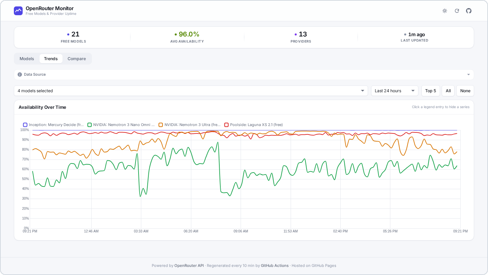
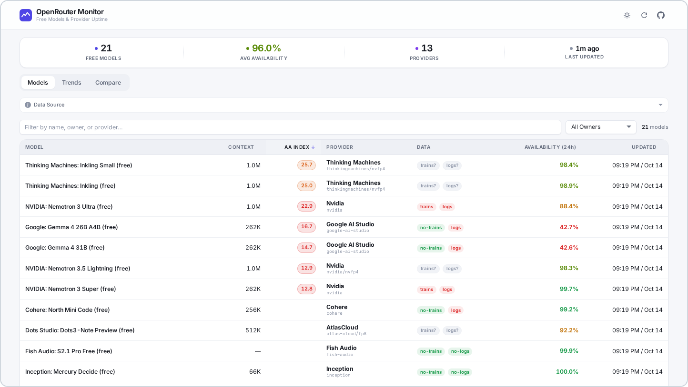
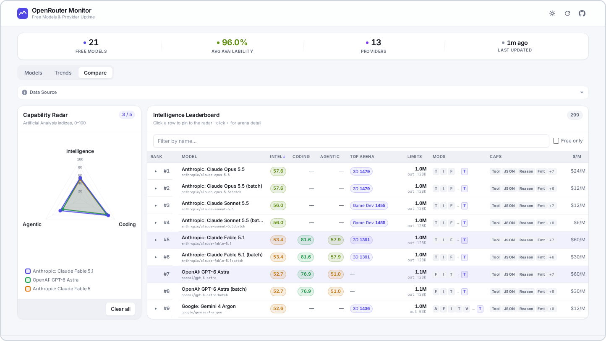

# OpenRouter Monitor

Dashboard for the free models on [OpenRouter](https://openrouter.ai): availability, providers and benchmark scores.

Live: https://black-night-heron.github.io/openrouter-monitor/



<details>
<summary>Models and Compare tabs</summary>





</details>

## How it works

Each run of the Pages workflow:

1. Downloads the previous snapshot from the `gh-pages` branch.
2. Queries OpenRouter for the model catalog, per-model availability, provider lists and benchmark scores.
3. Merges the new values into a grid of 10-minute buckets covering the last 30 days.
4. Pushes the result to `gh-pages` as a single commit.

## The data files

- `https://black-night-heron.github.io/openrouter-monitor/data/dashboard.json`: 24h availability, OpenRouter's summary numbers, and its providers with data-policy flags.
- `https://black-night-heron.github.io/openrouter-monitor/data/uptime.json`: availability history, 10-minute buckets, last 30 days.
- `https://black-night-heron.github.io/openrouter-monitor/data/benchmarks.json`: Artificial Analysis and Design Arena scores.

## Development

```bash
npm install
npm run typecheck
npm run collect
```

A `collect` run without `SEED_DIR` starts with empty history. `SEED_DIR` points to a folder containing the previous `uptime.json`, `benchmarks.json` and `dashboard.json`.

## License

[MIT](LICENSE)
